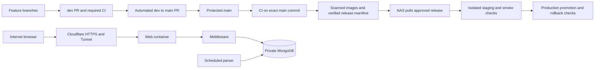

# From the current branches to an automated Synology deployment

Prepared November 14, 2026 for `rfarnsworth913/game-guides` and the Synology DS1522+.

This is an implementation runbook, not an executed deployment. Branch heads were checked remotely, local checks were run, and the current code was inspected. No branches were merged, GitHub settings changed, containers deployed, or NAS database records modified. Complete each exit gate before proceeding.

The earlier [implementation guide](implementation-guide.md) contains historical branch/toolchain snapshots. Use the branch state and toolchain below for this rollout; do not repeat its unrelated-history reconciliation against the present branches.

## 1. Current starting point and blockers

Remote heads were verified with `git ls-remote`:

| Item | Verified state |
| --- | --- |
| Remote `dev` | `7abdb751bddcbbb223db9cc3db6b7f51498eb46c` |
| Remote `main` | `ed1b77a82cf7dc7e195f071a316c63ada60747cc` |
| Relationship | Common ancestor `979c82773fcd9fdf3b219b39634c98e3a83c46d3`; **16 main-only / 35 dev-only commits** |
| Current local checkout | `dev`, matching `origin/dev` |
| Local `main` | Stale at `737a0a1`; still tracks `.env` in that old tree. Current `origin/main` does not track it. Avoid switching directly to that stale local branch. |
| Untracked work | Two parser review documents and `src/assets/arknights-endfield/yuanyuan-blazing-stoves-4fbde888-8e76-4994-84ac-ae3e3277b044.webp` |
| Runtime baseline | `.node-version`: `26.13.0`; lockfile/package manifest exist. `packageManager` names npm `10.8.2`; align the actual build toolchain deliberately. |
| Existing CI | Hosted Ubuntu lint/test/build matrix plus a separate browser-integration workflow |
| Existing CodeRabbit configuration | Reviews main/dev/ai; `request_changes_workflow: false`. Installation and enforcement settings were not verified. |
| Deployment packaging | No Dockerfiles, Compose deployment, Nginx config, image-publishing or NAS deployment workflow found |
| MongoDB | NAS migration was configured in the preceding work. Actual server version/FCV and mount ownership must be recorded before deployment; do not infer them solely from an image screenshot. |

Local checks on the current working tree:

| Check | Result |
| --- | --- |
| `npm run lint:ci` | Pass: **0 errors, 11,970 warnings**. Not a warning-free baseline. |
| `npm run ui:build` | Pass, with initial bundle and component stylesheet budget warnings |
| `npm test` | **Fails** in Angular: 60 middleware tests pass; Angular has 181 pass / 1 fail. The command stops before the parser suite. |
| `npm run parser:test` separately | Pass: **107 tests** |
| `npm run ui:e2e` | Not run as part of this planning audit; remains a required verification step, not an assumed pass |

The known failure is `dashboard.spec.ts`, test **"restores saved status and multiple types after recreating the dashboard and persists resets"**. The initial fixture sets November 12, 2026, but the recreated fixture uses the real current clock. Its November 14 event is now active rather than upcoming. This is a test-clock defect; preserve the assertion and initialize every recreated fixture with the same fixed clock.

## 2. Recommended end state



Use Container Manager Compose projects for the application. The linked [Synology hosting guide](https://kb.synology.com/en-us/DSM/tutorial/How_to_host_a_website_on_Synology_NAS) focuses on Web Station and PHP packages; uploading Angular files there alone will not run this Node middleware/parser. Its hostname, certificate and firewall concepts are relevant, but the application needs its own API routing and runtime packaging.

The linked [XDA article](https://www.xda-developers.com/how-i-hosted-a-website-on-my-nas-from-home/) could not be retrieved during this audit (502); no unverified instructions from it are treated as prerequisites. The recommendations below use repository evidence and linked primary documentation.

Preferred public ingress: **Cloudflare Tunnel**, with no router forwarding to the NAS. It is outbound initiated and can map a public hostname to the web service. [Cloudflare documentation](https://developers.cloudflare.com/tunnel/concepts/)

Alternative if you prefer direct hosting: public DNS/DDNS, router TCP 443 forwarding, DSM reverse proxy and a valid certificate. First verify public-IP/CGNAT and ISP constraints. Do not expose DSM, SSH, Docker, middleware or MongoDB as separate internet ports. Choose one ingress architecture rather than configuring both accidentally.

## 3. Preserve work and inventory the NAS

1. Review the untracked files above. Commit the intended documents/image on `dev` using explicit paths, or preserve them outside the checkout. Do not use `git add .` or commit `.env`.
2. Copy the working `.env` to a private location outside Git before touching old branches. Check tracked filenames without printing file contents:

   ```powershell
   git status --short
   git ls-files -- .env
   git fetch origin --prune
   git rev-list --left-right --count origin/main...origin/dev
   git merge-base origin/main origin/dev
   ```

3. Confirm the heads/counts still match this guide; if they changed, re-audit the new commits. Do not force branches to the snapshot hashes.
4. Create uniquely named backup refs for the fetched branch tips, without overwriting existing refs:

   ```powershell
   git branch backup/main-before-nas-20261114 origin/main
   git branch backup/dev-before-nas-20261114 origin/dev
   ```

5. Record the exact NAS model, DSM/Container Manager versions, available memory/disk, MongoDB image digest/server version/FCV, container name, current volume mappings and data ownership. Verify the selected images actually run on the NAS CPU/kernel. DSM version has not yet been provided.
6. Reserve the NAS LAN address. Decide the real production hostname, staging hostname, domain/DNS ownership, and whether public reads should be open to everyone or limited to invited users.
7. Back up the complete application database, including account-progress and schema-backup collections, plus image files and metadata sidecars. Keep another copy off the NAS and test a restore. A RAID array or an application JSON export is not a complete database-and-files backup.
8. Review historical secret exposure. An old local main tree tracks `.env`, and a database password was shown during setup. Rotate exposed credentials and assess Git history before making the repository public. Do not print secrets while investigating history.

**Exit gate:** all intended work is preserved, the live database/mount is identified, and a tested restore exists. No branch sync or container replacement has happened yet.

## 4. Repair and establish all required checks

1. Fix the known dashboard test on a short-lived repair branch based on current `dev`. Set the same reference date on the initial, refreshed and reset dashboard components before `detectChanges()`, or use an injected/fake clock consistently. Do not change the expected upcoming result to fit today's date.
2. Run the normal gates from a clean install using the chosen Node/npm versions:

   ```powershell
   npm ci
   npm run lint:ci
   npm test
   npm run ui:build
   ```

3. Keep lint warnings nonblocking initially because the current script intentionally fails on errors only. Record the warning count and reduce it in separate focused PRs. Do not introduce `--max-warnings=0` until the baseline supports it, or add `continue-on-error` to hide failures.
4. Run browser integration with a **disposable local/CI MongoDB**, isolated database/user, uploads and browser profiles. Explicitly set `E2E_MONGODB_URI`; never supply the NAS production URI. The current harness creates a random database and drops it afterward, so its connection must never have access to production data.

   ```powershell
   $env:E2E_MONGODB_URI = 'mongodb://127.0.0.1:27017'
   npm run ui:e2e
   ```

   This example requires a dedicated disposable MongoDB already listening at that address. Do not point it at an unrelated persistent local database server and assume the test user is safe. In CI, retain the service-container pattern. Test the selected production server major in the integration matrix; the existing job uses `mongo:7`, while the NAS setup screenshot used 9.0.
5. Keep test issuer/JWKS/token injection confined to the harness. Verify guest access, login, editor denial/allow, account isolation, persistence, conflicts, image uploads and logout. The synthetic issuer suite does not replace a real Google/Auth0 staging login test.
6. Add container integration tests once images exist: boot the exact candidate web/API images against disposable MongoDB and run the browser/security checks through the production proxy path.
7. Add dependency, secret, static-code, workflow and container-image scanning. Triage runtime and build-time dependencies; do not treat a clean `npm audit --omit=dev` as coverage of the build pipeline. Use documented, expiring exceptions for findings that are reviewed rather than silently suppressing a scanner.
8. Confirm the Node MongoDB driver supports the chosen server and Node versions. The manifest currently pins driver `6.4.0`; successful ping alone is insufficient compatibility evidence. Choose an upgrade using the [official compatibility table](https://www.mongodb.com/docs/drivers/compatibility/?all-languages=nodejs&interface=driver), then run persistence/integration tests. Do not downgrade the NAS database merely to match an old CI image.

**Exit gate:** all normal and browser gates pass reproducibly on the candidate branch. Record exact toolchain and test results. The current checkout does not yet satisfy this gate.

## 5. Reconcile main and dev without discarding either history

Use an isolated worktree so the current `.env`, ignored files and untracked work cannot be replaced by an old branch checkout. The following commands are examples for a maintainer; they have not been executed:

```powershell
git fetch origin --prune
git worktree add -b sync/main-into-dev-20261114 D:/projects/game-guides-reconcile origin/dev
Set-Location D:/projects/game-guides-reconcile
git merge --no-ff --no-commit origin/main
```

1. Inspect main-only changes and resolve conflicts one file at a time. Preserve application behavior and maintained changes from both branches; do not use blanket `ours`, `theirs`, reset or force-push commands.
2. Resolve `package.json` deliberately and regenerate the lockfile with the selected toolchain where needed. Keep `.env` untracked and `.env.example` nonsecret. Confirm image sidecars and tracked assets survive.
3. Review the staged changes, including removals, then commit the integration and push only that temporary branch:

   ```powershell
   git diff --check
   git status --short
   git diff --cached --stat
   # Stage reviewed files explicitly, then:
   git commit -m "Reconcile main changes into dev"
   git push -u origin sync/main-into-dev-20261114
   ```

4. Open a PR from the integration branch to `dev`. Require CI and review. The conflicting merge above must be resolved/staged first; do not run the commit command with unresolved paths.
5. After that PR lands and `dev` is green, open **`dev` -> `main`**. Use a merge commit for these long-lived branch promotions. Do not delete `dev` after merging.
6. Merge the resulting main merge commit back into dev through a sync PR. This keeps ancestry aligned for the next release. Automate this sync later, but stop and request review on conflicts.
7. Check both branch tips and compare their trees. They need matching intended content and compatible ancestry; forcing the same commit SHA is not necessary when PR merge commits differ.

This is ordinary reconciliation between related histories. **Do not use `--allow-unrelated-histories`**, despite the older implementation guide's historical instructions.

**Exit gate:** the current main-only changes are integrated and tested in dev; main receives the reviewed dev tree through a PR; reverse sync does not start an endless release loop.

## 6. Protect branches and automate the release PR

1. Enable repository auto-merge if available for the repository/account plan. Configure `main` and `dev` rulesets: require PRs, required checks, conversation resolution, no force pushes and no branch deletion. Keep emergency bypass tightly controlled and logged. [GitHub auto-merge](https://docs.github.com/en/pull-requests/how-tos/merge-and-close-pull-requests/automatically-merging-a-pull-request), [branch protection](https://docs.github.com/en/repositories/configuring-branches-and-merges-in-your-repository/managing-protected-branches/about-protected-branches)
2. Retain CodeRabbit on dev and main, and verify it actually runs on a test PR. Its current configuration is not proof of a blocking approval gate. Decide which actual check/review status will block merges; test a deliberately failing example. AI review is one input, not a security certification.
3. If another maintainer can review, require an approving review and dismiss approvals when substantive changes arrive. If you are the only maintainer, do not require an approval that you cannot provide on your own PR; use an explicit release-approval policy plus automated checks, with manual review of auth, deployment, data migrations and workflow permission changes.
4. Consolidate or coordinate required jobs so there is one clearly named **`release-ready`** gate depending on lint, all tests, production build, browser/container integration and required security checks. It must fail if a dependency fails, is cancelled, or is unexpectedly skipped. Do not create an always-green aggregator.
5. Run checks on PR changes and on the exact main commit after merge. Keep external PR jobs on GitHub-hosted Ubuntu runners with read-only permissions, no NAS secrets and no production connection strings. Preserve the existing Chrome sandbox setup; do not fix browser failures by disabling sandboxing globally.
6. Add a narrowly scoped GitHub App for release-PR automation. On a successful dev check set, create or update one PR from dev to main and enable auto-merge. It may create/manage PRs and read required status; it must not bypass rulesets.
7. Use an App installation token for PR creation where normal PR CI must trigger. Events created with the built-in `GITHUB_TOKEN` often do not start another workflow. Do not assume the release PR has been tested just because a bot created it. [GitHub event-trigger documentation](https://docs.github.com/en/actions/how-tos/write-workflows/choose-when-workflows-run/trigger-a-workflow)
8. Before creating a release PR, compare branch **trees**, not just ahead counts. A reverse-sync merge with no content difference must not trigger a new release PR. Restrict automatic promotion to the expected repository, base `main`, head `dev`, non-draft state and current checks; feature/fork PRs do not receive release privileges.
9. Enable auto-merge using the actual PR number, for example `gh pr merge <PR_NUMBER> --auto --merge`. This queues merging after all configured requirements; it does not replace those requirements. Do not use `--admin`, force-merging, or delete the persistent dev branch.

**Exit gate:** a dev push causes the expected checks, one release PR and a gated merge. An intentionally failing check blocks main. A no-content reverse sync creates no new release.

## 7. Build production images and retain immutable releases

Create these files through reviewed PRs; none exists yet:

| Deliverable | Purpose |
| --- | --- |
| Root `.dockerignore` | Excludes `.git`, `.env`, database files, node_modules, temporary test/browser data and private uploads from build context |
| Web Dockerfile and Nginx config | Production Angular bundle, SPA fallback and same-origin `/api` proxy |
| API Dockerfile plus build/start target | Production middleware runtime, preserved aliases/shared code and health check |
| Parser Dockerfile plus scheduled start target | Separate runtime with Chromium dependencies and bounded execution |
| `deploy/compose.yml` | Reviewed service/network/volume contract; no embedded secrets |
| `scripts/deploy/*` | Release validation, backup, staging, promotion, smoke checks and rollback |
| Image/release workflow | Packages only the tested main commit, scans images and publishes immutable digests |

1. Build on hosted CI and target `linux/amd64` for this NAS. Use the pinned Node baseline and lockfile; run compiled production services, not `ng serve` or `node --watch`.
2. Add a real backend build target or explicitly package the TypeScript runtime. Currently `tsx` is a dev dependency and the API imports shared TS modules; simply running `npm ci --omit=dev` and the existing source command will not yield a working deployment. Prefer a tested Node ESM build/bundle with runtime dependencies and no test harness code.
3. Make middleware bind address configurable: container runtime needs `0.0.0.0` internally; local development can retain `127.0.0.1`. Do not publish its port to the public network.
4. Make the upload root configurable or mount the volume at the exact source-relative asset path expected by the packaged API. Copy existing images **and JSON sidecars** into the persistent NAS volume once. An empty bind mount can hide packaged files; deployments must not replace the upload volume.
5. Implement `/api` proxying before SPA fallback so failed API requests do not return `index.html`. The Angular development proxy file is not a production reverse proxy. Preserve Authorization, request method, body and Origin; disable caching of auth/private API responses. Match the API's 10 MB upload limit plus multipart overhead at every proxy.
6. Build a separate parser image with headless configurable, Chromium and its libraries, a writable temporary browser profile, controlled concurrency and no broad NAS mount. Retain the browser sandbox where supported; validate it on DSM rather than assuming the Ubuntu CI recipe transfers unchanged.
7. Publish web/API/parser to GHCR under immutable SHA tags and record their image digests. Pin base images and third-party actions by reviewed digest/full SHA, updating through reviewed dependency PRs. Do not deploy `latest` or build source on the NAS during release.
8. Generate an SBOM and provenance/attestation for each release image and a manifest containing commit SHA, digests and schema compatibility/migrations. Limit publishing permissions to trusted main jobs. [GitHub image registry](https://docs.github.com/en/packages/working-with-a-github-packages-registry/working-with-the-container-registry), [artifact attestations](https://docs.github.com/en/actions/how-tos/secure-your-work/use-artifact-attestations/use-artifact-attestations)
9. Validate a candidate by running those exact image digests in CI against disposable services. After merge, publish from the checked main SHA, not an unrelated PR-head artifact or a mutable branch tag.

**Exit gate:** exact release images boot, route correctly, preserve uploads/progress and pass the container/browser/security suite. Images contain no deployment credentials, database dumps or production `.env`.

## 8. Prepare the NAS deployment layout and staging

Use a layout similar to the following; substitute the real volume/share paths:

```text
/volume1/docker/game-guides/
  deploy/                 reviewed Compose and local deployment scripts
  secrets/                restricted runtime credentials and tunnel token
  releases/               verified manifests and current/previous state
  staging/uploads/        isolated staging image library
  production/uploads/     persistent production images and sidecars
  backups/                DB/files backups; copy off NAS too
  logs/                   rotated application/deployment/parser logs
```

1. Use Container Manager Projects for repeatability. Confirm actual Compose command/support on the installed DSM version before scheduling commands. Do not manually modify Synology-managed system Nginx files. [Synology Projects](https://kb.synology.com/en-global/DSM/help/ContainerManager/docker_project)
2. Preserve the existing MongoDB container and persistent mount during application deployment. Record its project/name/digest before changes. If adopting it into Compose later, stop it and recreate against the same verified data mount deliberately; never run two `mongod` processes against that directory or create an accidental empty replacement database.
3. Use separate production and staging database names, DB users and upload volumes. Seed staging with fixtures or appropriately sanitized copies; staging must not write production progress.
4. Use network separation: tunnel -> web; web -> API; API/parser -> database. Only API/parser need database credentials. API also needs outbound Auth0/JWKS access and parser needs source-site egress. An internal-only data network therefore needs an additional egress network on those services; MongoDB itself needs no public port.
5. Attach existing MongoDB and application services to a reviewed user-defined network with an explicit alias. When all clients run on the NAS, use that stable service/alias and internal port 27017, not the current host-published `192.168.1.200:32768`. Keep any temporary Compass port LAN/VPN restricted, then remove it when no longer required.
6. Run application containers as non-root, drop unnecessary capabilities, set memory/CPU/PID limits and rotate logs. Give only the required upload path write access. Database permissions must match its image UID; do not grant Everyone write access to solve a mount error.
7. Store application/parser DB credentials, editor subjects, registry-read credentials and tunnel tokens in restricted NAS configuration, not Git or image layers. The current app reads env variables, so a protected NAS-only `env_file` is an interim option; `_FILE` secrets require application support rather than being assumed.
8. Use different DB users for the application and parser where practical. Keep the database administrator for backup/maintenance. Preserve Auth0 issuer/subject identity so account keys remain compatible.
9. Keep scheduled parser writes disabled initially. Complete the high-risk date/cleanup/identity work in the [parser report](parser-review-2026-11-12.md) before unattended writes to production. Job success must reflect actual source/write failures; prevent overlapping runs and cap duration.

Suggested minimum environment contract:

| Service | Settings |
| --- | --- |
| API | Production mode, API port/bind address, Mongo URI, database/collection, exact HTTPS `APP_ORIGIN`, editor subjects, upload root |
| Web | API upstream on private container network; production Angular assets/public Auth0 configuration |
| Parser | Parser-specific Mongo URI, DB/collection, configurable headless/timeouts, writable temp path; no Auth0 editor privileges |
| Tunnel | Dedicated tunnel token/credential and only the web origin route |
| Local deploy task | Read-only release/registry access, approved repo/workflow/digest verification policy; no arbitrary remote shell payload |

**Exit gate:** a manually deployed staging release uses isolated state; restart preserves its files and DB; production MongoDB was not reset or exposed.

## 9. Automate deployment without exposing a NAS runner to PRs

Recommended default: **NAS pulls verified releases**. GitHub builds/publishes; a fixed local NAS task checks for eligible releases every few minutes. This requires no inbound SSH/webhook and no long-lived NAS administrator credential in PR workflows.

1. Install a reviewed local deploy script and schedule it through DSM Task Scheduler. Acquire an exclusive lock so tasks cannot overlap. Docker control is effectively administrative power; the script and its directory must be writable only by trusted administrators.
2. Retrieve a release manifest for the expected repository from the publishing workflow. Use registry/release read-only credentials if private. Do not execute a downloaded shell script or arbitrary Compose file from a release.
3. Verify provenance/signatures, expected repository, workflow, protected main ref, commit and image digests. A digest alone provides integrity, not approval/provenance. Confirm account-plan/tool availability for attestations and deploy a tested signature alternative if needed. [Verification reference](https://cli.github.com/manual/gh_attestation_verify)
4. Validate the manifest against a strict schema/allowed image names/digest syntax. Update only approved image references and release metadata in the locally reviewed Compose contract. Do not interpolate unvalidated manifest values into shell commands.
5. Pull all images first. If downloads/verification fail, keep the existing release running and notify; the NAS being offline must not result in half a deployment.
6. Deploy the candidate to isolated staging. Run proxy/API health, frontend asset/deep-link checks, synthetic account isolation, editor authorization, completion persistence and upload checks. Keep staging behind restricted access.
7. For the first release and auth/schema/workflow changes, require explicit approval before promotion. Enable unattended routine promotions only after successful deployments and a demonstrated rollback; make automatic eligibility part of the verified release policy.
8. Before production promotion, pause the parser, drain/stop writes for a consistent DB/files backup, record old digests and schema state, then apply compatible migrations once. This app currently calls migration-capable repository initialization on API startup; test and account for that before treating API replacement as a harmless rollback.
9. Start the production candidate, run health/smoke checks through its actual origin, and switch traffic only after it is healthy. For initial deployment, a brief maintenance window is simpler than unsafe blue/green against changing schemas. Zero downtime can be added after schema compatibility guarantees exist.
10. Record current/previous digests and deployment result. Re-enable the parser only after the app and schema are verified. Failures must send a local notification and retain logs without secrets.

Do not use Watchtower-style unreviewed `latest` updates for this application/database, and do not auto-upgrade MongoDB as part of ordinary web releases. Avoid running public/fork PR code on the NAS or any runner with LAN/production access. [GitHub runner security](https://docs.github.com/en/actions/reference/security/secure-use)

**Exit gate:** a published eligible release deploys without a development PC, failed verification does not change production, and deployment logs identify exact digests and outcomes.

## 10. Configure staging and production HTTPS/Auth0

1. Register/control the chosen domain and create separate names, for example `staging.guides.example.com` and `guides.example.com`. The names in this guide are placeholders.
2. For Tunnel ingress, create a dedicated tunnel/connector on the NAS and route only the website hostname to the web container. Add a default reject route where applicable. Keep DSM/SSH and staging behind a VPN or restricted Access policy; do not publish a wildcard route to the NAS.
3. Use Cloudflare HTTPS at the edge and the outbound tunnel to the origin. HTTP on the private connector-to-web hop is acceptable only within the controlled host/container network; use verified origin TLS if crossing an untrusted network. Do not enable TLS verification bypass to make certificates work.
4. For direct DSM ingress instead, configure hostname-specific reverse proxy, a trusted renewable certificate, firewall rules and router TCP 443 only. Use correct origin TLS validation and remove alternate routes that could bypass the intended edge controls. Monitor certificate renewal.
5. Configure Auth0 for the exact HTTPS origin. With the current root redirect/logout code, production entries are:

   ```text
   Allowed Callback URL: https://guides.example.com/
   Allowed Logout URL:   https://guides.example.com/
   Allowed Web Origin:   https://guides.example.com
   APP_ORIGIN:           https://guides.example.com
   ```

   Add staging equivalents only to the intended client; retain local development entries only where needed. Use explicit URLs rather than broad wildcards. Preserve issuer/audience/account mapping; changing tenants changes account identity. Public SPA domain/client ID/audience belong in frontend configuration, while editor allowlists/DB credentials do not. [Auth0 Angular SDK](https://github.com/auth0/auth0-angular)
6. Verify real Google login, browser refresh, new-tab session behavior, logout and access-denied states through the staging hostname. If using a new production Auth0 application/tenant or Google connection, validate its settings and production credentials separately; source changes do not configure the provider.
7. The origin validator requires the exact configured Origin for authenticated writes. Preserve it through proxies. Do not set `APP_ORIGIN` to `http://api:3001` or change it based on an untrusted forwarded header.
8. API responses containing account/auth data must have no-store behavior at the app/proxy/edge. Bypass caching for `/api/*` initially, including errors. Cache only versioned static assets appropriately and avoid long caching of `index.html`; do not cache bearer-token traffic as public content.
9. New public origins have separate browser localStorage. Export/import guest progress where desired before abandoning the localhost origin; account progress remains in MongoDB. Device-local reading positions and dashboard filters do not automatically migrate to another origin.

**Exit gate:** private staging works through the final ingress path, exact Auth0 URLs succeed, private responses are not cached, and uploads/deep links work.

## 11. Complete the public-exposure security gate

"All security checks" is not a one-time guarantee. Use an explicit tested gate and ongoing patch/backup ownership. Mark the following complete with evidence before removing staging restrictions:

| Area | Required configuration / verification |
| --- | --- |
| NAS administration | Current DSM/Container Manager security updates, administrator MFA, no default/shared admin use, reviewed DSM permissions; DSM/SSH reachable only through LAN/VPN/restricted access |
| Network | Only the selected web ingress is public; MongoDB 27017/32768, middleware 3001, development 4200, Docker socket, SMB and DSM admin ports are unreachable from the internet; review IPv6 and UPnP exposure too |
| Auth0/API | Validate issuer, audience, signature, expiry and intended client; enforce editor role and account isolation on the server, not UI controls alone; wrong/expired tokens fail |
| Proxy/client identity | The current limiter keys on `request.socket.remoteAddress`, which becomes a proxy/container address. Fix trusted-proxy client-IP handling or enforce a verified edge policy; strip spoofable headers and accept client IP only from the controlled proxy path. Do not blindly trust internet `X-Forwarded-For`. |
| Rate/resource limits | Test login/auth, progress writes and image uploads; bound public expensive reads, request size/timeouts, containers and storage. Shared proxy IP must not cause all users to exhaust one quota. |
| Security headers | Add/test CSP suitable for Angular/Auth0, frame restrictions, nosniff, referrer and permissions policy. Test CSP in report-only mode first and enforce it before launch; add HSTS after HTTPS is proven. Do not add unsafe-inline/eval casually. |
| Tokens/XSS | SPA tokens currently use localStorage, making XSS prevention particularly important. Verify markdown/link sanitization, safe DOM handling, dependency patches and CSP. Logout clears client state; it does not invalidate every previously issued bearer token. |
| Uploads | Validate extension/content/MIME, filename/path traversal, size and authorization; uploaded content cannot execute as scripts. Verify serving headers and that sidecars/private paths are not publicly enumerable beyond the intended library. |
| Data/API exposure | Review anonymous catalogs and `/parsed` output intentionally; raw shared documents must not contain secrets or private account data. Deny production exposure of debug/source maps/backups/dotfiles. |
| Supply chain | Protected workflows, minimal token permissions, dependency review, secret scanning, static/image scanning, reviewed pins, build provenance and immutable release deployment |
| Secrets | Root/container/screenshot-exposed credentials rotated; app DB user scoped to application DB; no secrets in Git, images, browser bundles, artifact logs or third-party build caches |
| Recovery | Successful isolated DB-plus-assets restore; compatible image rollback demonstrated; backups copied off NAS and monitored; migration rollback is not assumed to be image rollback |
| Monitoring | Alerts on failed deploy/parser jobs, stale source data, API errors/health, storage pressure and backup failures; rotated logs redact tokens/passwords |

The middleware already sets nosniff/referrer headers and uses verified Auth0/editor checks. It does not currently provide all of the proxy, CSP, cache and deployment controls above. A WAF or passing unit suite does not supply those missing controls automatically.

Run safe external checks from another network, such as a mobile connection: HTTPS/certificate chain, routes, authorization failures, public port exposure and response headers. Perform passive/staging DAST and permission tests without destructive production scans. Keep a deployment record of findings and fixes; do not declare the service secure solely from a scanner score.

## 12. First public release and routine operations

1. Freeze writes, take a final database/assets backup, pause parser jobs and publish a maintenance notice if needed.
2. Deploy one verified main release to staging, approve the first production promotion and run the same public-origin smoke checklist.
3. Confirm catalog IDs, game counts, multiple users' progress, editor writes, conflicts, uploads, deep links, real Auth0 login/logout and refresh persistence. Do not test account isolation with production credentials committed into a script.
4. Open production ingress only after the security gate. Observe logs/resource use and confirm no direct-origin or database exposure remains.
5. Re-enable reviewed scheduled parser jobs one at a time with lock, timeout, failure status and freshness alerts. NAS timezone must not be mistaken for the game-server reset timezone.
6. Keep automatic deployment eligible only for releases that passed the exact main-commit gates and provenance verification. Use an approval hold for migrations/security-sensitive changes until a stronger automated policy is demonstrated.
7. Test rollback: route back to previous web/API digests only if the data schema remains compatible. If migration restoration is required, stop writers and restore the consistent DB/assets checkpoint deliberately; protect writes accepted after that checkpoint from silent loss.
8. Maintain the normal flow: feature -> reviewed dev -> automated release PR -> protected main -> tested/scanned release -> verified NAS staging -> production promotion. Back-merge main into dev without generating releases for identical trees.

## 13. Suggested implementation PRs and completion checklist

| PR | Concrete scope | Completion evidence |
| --- | --- | --- |
| 1 | Date-stable dashboard test and toolchain alignment | Normal test/build/lint gates pass on supported tooling |
| 2 | Main/dev reconciliation | Both histories preserved, required checks green, no tracked `.env` |
| 3 | Required CI gate, isolated browser job, security scans and CodeRabbit enforcement | Deliberate failures block merging; fork jobs have no deployment access |
| 4 | Production web/API/parser packaging, proxy, bind/upload config | Exact images pass disposable container/browser tests; no secrets baked in |
| 5 | Runtime security hardening and driver/server compatibility | Proxy, Origin, account isolation, headers, cache and upload tests pass |
| 6 | Immutable image/provenance publishing and release-PR automation | Tested main SHA produces verifiable digests; no automation loops |
| 7 | NAS Compose, secrets/volumes, pull deployment and rollback scripts | Isolated staging, backup/restore, restart persistence and failure-safe deployment demonstrated |
| 8 | Domain/Tunnel or DSM ingress, Auth0 production URLs, security verification | HTTPS works externally; only intended services are exposed |
| 9 | Controlled public launch, alerts and parser scheduling | Observed production health and tested rollback; documented operational owner |

Keep external setup tasks tracked separately from Git changes: GitHub rulesets/App/CodeRabbit installation, GHCR permissions, DSM accounts/Tasks/volumes, domain/DNS/Tunnel and Auth0 settings are not applied by committing YAML or this document.

Completion means: dev/main reconciled; all required checks green; promotion and deployment gating verified; NAS hosts the exact released images and persistent state; internet access uses HTTPS and tested authorization/network boundaries; backup, monitoring and rollback work. This guide itself does not assert those tasks are complete.
